# @mugsun/track-web

**[English](./README_EN.md)** | 简体中文

<p>
  <a href="https://www.npmjs.com/package/@mugsun/track-web"></a>
  <a href="https://bundlephobia.com/package/@mugsun/track-web"></a>
  
  
  
</p>

mugsun 平台的 Web 端行为埋点 SDK。框架无关的插件化内核，附带官方 Vue 3 集成。

core 产物 gzip 约 5.5KB（构建实测，体积门禁 ≤ 8KB），以 TypeScript 严格模式编写。core 不依赖 DOM，存储、传输、时钟均为注入式，因此单元测试可直接在 Node 环境运行，当前 vitest 149 个用例。

## 设计要点

- **体积**：core gzip 约 5.5KB；会话回放位于独立子路径，按需懒加载，不进主入口首包。
- **插件化**：6 个默认插件开箱可用，3 个可选插件（接口监控、会话回放、圈选埋点）需显式注册。
- **投递可靠性**：批量队列以 IndexedDB 持久化，断网或刷新后按指数退避补发；传输走 sendBeacon → fetch keepalive → XHR 降级链，可选 gzip 压缩（CompressionStream）。
- **幂等**：`event_id` 由 `crypto.randomUUID` 生成且跨重发稳定，服务端据此去重，重复投递不会重复计数。
- **会话口径**：30 分钟滑动过期，状态存 localStorage；同浏览器多标签页共享一个会话，任一标签页活动即续期。
- **采样稳定性**：按 anonymous_id 哈希分桶，会话级结果一致，同一用户不会被反复抽中或排除。
- **隐私默认值**：尊重 DNT，提供 `optOut()`；不采集输入框值，password 输入框与自定义选择器命中的子树整块屏蔽。

## 数据流

```mermaid
flowchart LR
  subgraph browser["浏览器 · @mugsun/track-web"]
    direction TB
    P["插件层<br/>pageview / autocapture / exposure<br/>web-vitals / error / ..."]
    Q["批量队列<br/>10 条或 5s 双触发<br/>IndexedDB 持久化"]
    R["失败重试<br/>指数退避 base×2ⁿ 封顶<br/>容量超限丢最旧 · 24h 超龄丢弃"]
    T["传输降级链<br/>sendBeacon → fetch keepalive → XHR<br/>可选 gzip"]
    P --> Q --> R --> T
  end

  subgraph server["服务端 · mugsun-boot 埋点域"]
    direction TB
    I["摄入 /track/collect<br/>appKey 校验 → IP+appKey 分钟窗限流(429)<br/>批量截断 → 校时 → event_id 幂等(Redis 25h + DB 唯一键兜底)"]
    B["有界内存队列<br/>背压：丢新并计数，避免拖垮数据库"]
    C["批量消费<br/>UA/IP 富化 · 身份裁定 · 批量入库"]
    I --> B --> C
  end

  subgraph store["存储与聚合"]
    direction TB
    DB[("事件流水表<br/>track_event")]
    J["聚合任务<br/>5min / 天级统计 · web-vitals 直方图"]
    D["分析看板<br/>概览 / 事件 / 性能 / 错误<br/>回放 / 漏斗 / 留存"]
    DB --> J --> D
  end

  T -->|HTTPS 批量上报| I
  C --> DB
```



配套服务端为 mugsun-boot 的埋点域（采集接口 `/track/collect`、聚合任务、分析看板）。事件协议见下文，也可对接自建后端。

## 安装

```bash
npm i @mugsun/track-web
# 或
pnpm add @mugsun/track-web
# 或
yarn add @mugsun/track-web
```

<details>
<summary>本地联调 / 未发布场景：以 file: 协议引用源码仓</summary>

```bash
# 先在 SDK 仓内构建产物
cd mugsun-track && pnpm install && pnpm build

# 再在宿主项目引用
pnpm add @mugsun/track-web@file:../mugsun-track
```

</details>

## 获取 appKey

1. 在 mugsun 管理端进入 **埋点分析 → 接入管理**，新建应用，取得 appKey。
2. SDK 初始化时填入 appKey 与 `endpoint`（服务端地址）。
3. 服务端按应用下发采样率、总开关、屏蔽选择器与回放配置（`GET /track/config`），SDK 启动时自动拉取，调整采集行为无需改前端代码。

appKey 在浏览器中可见，不属于机密信息。服务端安全不依赖其保密，防护手段为存在性校验、限流、背压与事件级校验。

## 快速开始

### 任意站点（框架无关 core）

```ts
import { createTracker } from '@mugsun/track-web'

const track = createTracker({
  endpoint: 'https://your-server.com', // collect = {endpoint}/track/collect
  appKey: 'your-app-key', // 接入管理新建应用获得
  release: '1.0.0' // 应用版本号，构建注入；$error 携带
})

track.track('button_click', { name: 'buy' })
```

### Vue 3

```ts
import { createApp } from 'vue'
import MugsunTrack from '@mugsun/track-web/vue'
import router from './router'

const app = createApp(App)
app.use(MugsunTrack, {
  endpoint: import.meta.env.VITE_TRACK_ENDPOINT,
  appKey: import.meta.env.VITE_TRACK_APP_KEY,
  release: import.meta.env.VITE_APP_VERSION,
  router // 传入即启用路由集成：route_path 取 matched 路由模板，afterEach 驱动路由配对
})
app.mount('#app')
```

组件内可用 `inject(TRACK_INJECT_KEY)` 获取实例，模板外也可使用 `app.config.globalProperties.$track`。

登录与登出接线：

```ts
track.identify(userId) // 登录后绑定（映射落库由服务端按 token 裁定）
track.reset() // 登出：清空登录身份、更换 anonymous_id、轮换会话
```

## API

| 方法 | 说明 |
| --- | --- |
| `track(event, props?)` | 采集自定义事件；props 合并公共属性与超级属性 |
| `identify(userId)` | 绑定登录用户，上报 `$identify` 事件（user_id 放 props，事件级 user_id 由服务端按 token 裁定覆盖） |
| `reset()` | 登出或切号：清 user_id、更换 anonymous_id、开新会话 |
| `timeEvent(name)` | 开始计时；之后 `track(name)` 自动带 `duration_ms` |
| `cancelTimeEvent(name)` | 取消计时 |
| `registerSuperProperties(props)` | 注册超级属性（合并进之后所有事件） |
| `unregisterSuperProperty(key)` | 注销单个超级属性 |
| `flush()` / `flushBeacon()` | 立即冲刷；后者 beacon 优先，用于页面卸载场景 |
| `optOut()` / `optIn()` / `isOptedOut()` | 停止或恢复采集（持久化）；optOut 会清空待发队列 |
| `getDistinctId()` / `getUserId()` / `getSessionId()` | 读取当前身份与会话 |
| `setRoutePathProvider(fn)` | 提供路由模板来源（非 Vue 场景的路由双写） |
| `destroy()` | 拆卸插件与定时器 |

## v-track 指令（声明式埋点）

```vue
<template>
  <!-- 点击 -->
  <button v-track:click="'cta_click'">立即购买</button>
  <button v-track:click="{ event: 'cta_click', props: { pos: 'hero' } }">立即购买</button>

  <!-- 曝光：可见 ≥50% 且持续 ≥1s 才算有效曝光；同会话同元素同参数只记一次 -->
  <div v-track:exposure="{ event: 'banner_view', props: { id: 1 } }">...</div>
</template>
```

## 插件清单

| 插件 | 事件 | 默认 | 说明 |
| --- | --- | --- | --- |
| pageview | `$pageview` / `$pageleave` | 开 | history hook + popstate/hashchange；路由切换时上一页 `$pageleave`（带 duration_ms）与新页 `$pageview` 成对出现，首屏只有 pageview |
| pageleave | `$pageleave` | 开 | 基于 Page Visibility 统计停留（切后台停表），hidden/pagehide 兜底补发并立即 beacon 冲刷 |
| autocapture | `$click` / `form_submit` | 开 | 不采集 input/textarea 的 value；password 与 maskSelectors 子树整块屏蔽；文本截断 64 字符 |
| exposure | `$exposure` 或自定义事件 | 开 | IntersectionObserver：可见 ≥50% 且持续 ≥1s；同会话同元素同参数只记一次，虚拟滚动重复进视口不重复计数 |
| web-vitals | `$web_vitals` | 开 | PerformanceObserver 采集 LCP/INP/CLS/FCP/TTFB/longtask，页面首次隐藏时一次性上报；逐指标事件 `{metric, value}` 与服务端直方图聚合口径一致，longtask 统计随首条捎带 |
| error | `$error` | 开 | window error（捕获阶段，含资源加载错误）与 unhandledrejection；携带 release 与 error_fingerprint（message + 堆栈首帧 hash，服务端按指纹分组） |
| api-monitor | `api_request` | **关** | 包装 fetch/XHR，上报 url（去查询串）、method、status、duration、success；排除自身 `/track/*` 请求以防自埋点；可选响应体采集走独立通道 `/track/api-body`，内置敏感字段脱敏与字节安全阀；需显式加入 plugins |
| replay | 回放数据块，非事件 | **关** | 会话回放，常录 + 选择性上传 + 出错强传；独立入口 `@mugsun/track-web/replay`，详见「会话回放」 |
| visual-track | 圈选规则命中的自定义事件 | **关** | 圈选式可视化埋点，规则经 `/track/config` 下发，命中即上报；需显式加入 plugins，详见「圈选埋点」 |

会话事件为 `$session_start` 与 `$session_end`，30 分钟静默轮换时成对补发，`$session_end` 携带 duration_ms。

## 会话回放（G100）

基于 rrweb，入口独立、按需加载，不进主入口首包：

```ts
import { createTracker, defaultPlugins } from '@mugsun/track-web'
import { replayPlugin } from '@mugsun/track-web/replay'

createTracker({
  endpoint,
  appKey,
  plugins: [...defaultPlugins(), replayPlugin()]
})
```

**录制与上传语义（常录 + 选择性上传）**

- `replayEnabled`（本地配置或远端下发，下次启动生效）开启后才录制，数据进内存环形缓冲（最近 5 分钟或 10MB 滚动覆盖）；总开关关闭则完全不录。
- 会话命中 `replaySampleRate`（默认 10%，按 `${appKey}:${session_id}` 哈希分桶，会话级一致）时，在会话内分块上传。
- 会话内出现 `$error` 时忽略采样强制上传，错误发生前的缓冲一并带出，用于还原错误现场。
- 未命中采样且无错误的会话，缓冲随会话结束丢弃；主采样未命中或 optOut 的会话不录制。
- 分块规则为每 5 秒或 50 个事件切一块，`seq` 在会话内自增（从 0 起）；pagehide 时用 beacon 发送收尾块（明文同步编码，确保卸载前发出）。
- 传输走独立通道，不复用事件队列；单块失败按指数退避重试 3 次后丢弃，回放数据允许丢失，但不阻塞事件主队列。

**隐私默认值**：`maskAllInputs: true`（所有输入值记为 `***`）；文本不遮罩；`input[type="password"]`、`[data-track-mask]` 以及 `maskSelectors`（本地与远端下发合并）命中的元素整块不录；不采集 canvas。

**服务端要求**：`POST {endpoint}/track/replay`，body 为 JSON：

```json
{ "app_key", "session_id", "seq", "event_count", "gzip", "payload" }
```

- `payload` 恒为 base64。`gzip: true` 时解码后需再 gunzip（CompressionStream）；`false` 为明文 JSON 数组，对应降级路径与 pagehide 收尾块。
- 单块内容是 rrweb 事件 JSON 数组（含全量快照块与增量流块）。服务端按 `session_id` 聚合、`seq` 排序组装，丢块表现为 seq 空洞。
- 服务端组装后存入对象存储（私有桶，键为 `replay/{app_key}/{yyyyMM}/{session_id}/{seq}.gz`），元数据落 `track_replay` 表并联动 `track_session.has_replay`；回放数据保留期较短，默认 14 天。

## 圈选埋点（G104）

管理员在管理端生成带令牌的圈选链接，打开页面即进入圈选模式：悬停高亮元素、点击选定、填写事件名提交草稿。审核生效后规则经 `/track/config` 下发，命中元素被点击时按自定义事件上报，走主采样与主队列。

```ts
import { createTracker, defaultPlugins, visualTrack } from '@mugsun/track-web'

createTracker({
  endpoint,
  appKey,
  plugins: [...defaultPlugins(), visualTrack()]
})
```

- 圈选模式由 URL 上的 `__mst_inspect` 令牌激活，令牌由管理端签发，有效期 30 分钟；草稿走独立通道 `POST /track/visual/draft`，不进事件队列、不影响统计。
- 规则字段：`event`（事件名）、`selector`（CSS 选择器，≤512 字符）、`routePath`（限定路由模板，缺省为全站）、`matchText`（限定元素文本包含）。
- 无规则时不装监听，开销为零；password 与 maskSelectors 屏蔽的子树既不高亮也不可圈选。

### 自定义插件组合

```ts
import {
  createTracker,
  defaultPlugins,
  apiMonitorPlugin,
  pageviewPlugin
} from '@mugsun/track-web'

createTracker({
  endpoint,
  appKey,
  plugins: [...defaultPlugins(), apiMonitorPlugin()] // 显式开启接口监控
  // 或完全自定义：plugins: [pageviewPlugin({ manual: true }), ...]
})
```

## 配置项

| 配置 | 默认 | 说明 |
| --- | --- | --- |
| `appKey` | （必填） | 接入应用标识（浏览器可见，非机密）；管理端「埋点分析 → 接入管理」新建应用获得 |
| `endpoint` | （必填） | 服务端地址；collect = `{endpoint}/track/collect` |
| `release` | - | 应用版本号（构建注入），`$error` 等事件携带 |
| `sampleRate` | 100 | 本地采样率 0-100；远端下发优先，下次启动生效 |
| `enabled` | true | 本地总开关 |
| `batchSize` | 10 | 批量触发条数 |
| `flushInterval` | 5000 | 定时触发间隔（ms） |
| `maxBatchSize` | 100 | 单请求最大事件数 |
| `queueCapacity` | 500 | 队列容量上限，超出丢最旧 |
| `queueMaxAge` | 24h | 队列事件超龄丢弃（服务端幂等窗为 25h） |
| `retryBaseDelay` / `retryMaxDelay` | 1000 / 30000 | 补发退避基数与上限（ms），按 `base * 2^n` 封顶 |
| `respectDnt` | true | 尊重 Do Not Track |
| `maskSelectors` | [] | 自动采集屏蔽选择器，与远端下发合并 |
| `replayEnabled` | false | 回放总开关；远端下发可开启，下次启动生效，replay 插件据此决定是否录制 |
| `replaySampleRate` | 10 | 回放会话采样率 0-100，远端下发优先；只决定上传，不影响录制 |
| `apiMonitorEnabled` | false | 接口监控总开关；本地显式设置覆盖远端，未设置时由远端决定（需注册 api-monitor 插件） |
| `apiBodyEnabled` / `apiBodyMaskEnabled` / `apiBodyMaxBytes` | false / false / 1MB | 响应体采集、内置敏感键脱敏（`***`）、字节安全阀（超限不采并标记 `body_skipped=size`）；仅在接口监控开启后生效 |
| `visualRules` | - | 圈选规则；本地显式设置覆盖远端，未设置时由远端决定（需注册 visual-track 插件） |
| `sessionTimeout` | 30min | 会话滑动过期 |
| `storagePrefix` | `mst` | localStorage key 前缀 |
| `plugins` | 默认 6 插件 | 见插件清单 |
| `fetchRemoteConfig` | true | 启动时拉取远端配置 |
| `headers` | - | 上报附加请求头（如登录态 Authorization，供服务端身份裁定）；beacon 场景无法携带 |
| `debug` | false | 控制台调试日志 |

## 配置下发

启动时先使用上次缓存的远端配置，再异步拉取新配置写入缓存。请求为 `GET {endpoint}/track/config?app_key=xxx`，返回 R 信封，data 内包含采样率 `sampleRate`、总开关 `enabled`、屏蔽选择器 `maskSelectors`、回放开关 `replayEnabled`、回放采样率 `replaySampleRate`、接口监控开关系列与圈选规则 `visualRules`。

新配置在下次启动生效，会话中途不热更。配置拉取失败不影响采集。

## 事件协议

```
POST {endpoint}/track/collect
{
  app_key, schema_version,
  sdk: { platform: 'web', version },
  sent_at,
  events: [{ event_id, event, ts, distinct_id, user_id, session_id, props }]
}
```

- `ts` 为客户端原始时间，服务端存为 client_ts 并统一校时；`event_id` 为 crypto.randomUUID，跨重发稳定。
- 事件名：`$` 前缀为服务端保留字，仅白名单内的 `$` 事件可被接收；自定义事件名不带 `$`，须匹配 `^[A-Za-z][A-Za-z0-9_]{0,63}$`。
- 公共属性（写入 props）：`url_path`（原始路径）与 `route_path`（vue-router matched 路由模板，用于避免高基数）双写、page_title、referrer、UTM（着陆页归属）、screen、viewport、language、timezone、network、release。
- `distinct_id` 恒为 anonymous_id；`user_id` 由 identify 设置，最终以服务端 token 裁定为准。

## 隐私说明

- 浏览器开启 Do Not Track 且 `respectDnt`（默认开）时不采集。
- 调用 `optOut()` 后停止采集，并清空本地待发队列。
- 不采集 input/textarea 的 value；password 输入框与 `maskSelectors`（本地与远端下发合并）命中的子树整体屏蔽。
- 会话回放采用最严默认值：所有输入值记为 `***`，password 与 maskSelectors 子树整块不录，不采 canvas；主采样未命中或 optOut 的会话不录制。
- 不收集 cookie 与 localStorage 内容；接口监控上报的 url 去掉查询串，避免敏感参数外泄。

## 工程

```bash
pnpm install
pnpm build      # tsup：ESM + CJS + d.ts 三产物，并报告各产物 gzip 体积（core 门禁 ≤ 8KB）
pnpm test       # vitest（17 个测试文件 / 149 个用例）
pnpm typecheck  # tsc --noEmit（strict）
```

入口：

| 入口 | 内容 |
| --- | --- |
| `@mugsun/track-web` | createTracker 与默认插件集（含浏览器适配器） |
| `@mugsun/track-web/core` | 纯逻辑 core（零 DOM 依赖，体积门禁对象，gzip 约 5.5KB） |
| `@mugsun/track-web/vue` | Vue 插件（install / v-track / router 集成 / errorHandler 挂接） |
| `@mugsun/track-web/replay` | 会话回放插件（rrweb 动态 import 懒加载，不进主入口首包） |

提交信息规范见 [.github/COMMIT_CONVENTION.md](.github/COMMIT_CONVENTION.md)。

## Star History

[](https://star-history.com/#mugsun/mugsun-track&Date)

## License

MIT（见 `package.json` 的 `license` 字段）
