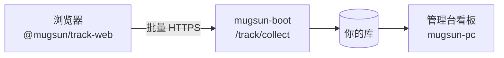

<p align="center">
  
</p>

# @mugsun/track-web

[English](./README_EN.md) | 简体中文

**把「采集 → 私有化服务端 → 看板」装进自己的仓库里带走。**  
core gzip 约 5.5KB；默认尊重隐私；会话回放不进首包。

[文档](https://docs.mugsun.com/track/) · [快速开始](https://docs.mugsun.com/guide/getting-started) · [npm](https://www.npmjs.com/package/@mugsun/track-web) · [在线演示（即将上线）](https://docs.mugsun.com/demo)

[](https://www.npmjs.com/package/@mugsun/track-web)
[](#为什么选它)
[](#工程)
[](./LICENSE)

---

## 为什么选它

多数埋点二选一：要么绑云厂商账号，要么自研一坨又重又难维护的脚本。`@mugsun/track-web` 走第三条路——

1. **数据在你自己的库里**：默认对接 [mugsun-boot](https://github.com/mugsun/mugsun-boot) 的 `/track/collect`，也可对接自建后端。
2. **首包够轻**：core ~5.5KB gzip；回放、圈选、接口监控按需挂载，不背锅。
3. **默认安全**：尊重 DNT；不采输入框内容；password 与自定义选择器整块屏蔽；可 `optOut()`。

它不是 Google Analytics，也不是又一个只能 SaaS 的产品分析云。

---

## 30 秒接入

```bash
pnpm add @mugsun/track-web
```

```ts
import { createTracker } from '@mugsun/track-web'

const track = createTracker({
  endpoint: 'https://your-server.com', // 实际上报：{endpoint}/track/collect
  appKey: 'your-app-key',              // 管理端「埋点分析 → 接入管理」新建
})

track.track('button_click', { name: 'buy' })
```

Vue 3 一行挂上路由与指令：

```ts
import MugsunTrack from '@mugsun/track-web/vue'
app.use(MugsunTrack, { endpoint, appKey, router })
```

更完整的路径（本地 compose → 看板看到第一条事件）见 [文档 · 第一个事件](https://docs.mugsun.com/track/first-event)。

---

## 它长什么样



> **截图占位**：公网 Demo 与看板截图就绪后放这里。当前请本地拉起 boot + pc 查看埋点看板。  
> 说明见 [演示](https://docs.mugsun.com/demo)。

---

## 和平台其它仓的关系

| 仓 | 角色 |
| --- | --- |
| **本仓** | Web SDK（可单独 npm 安装） |
| [mugsun-boot](https://github.com/mugsun/mugsun-boot) | 采集、限流、入库、聚合 |
| [mugsun-pc](https://github.com/mugsun/mugsun-pc) | 埋点看板与接入管理 |
| [mugsun-docs](https://github.com/mugsun/mugsun-docs) | 文档站 |

平级 clone 时，pc 用 `file:../mugsun-track`，需先 `pnpm build`（或跑 pc 的 `pnpm setup:sdk`）。日常业务项目直接 `pnpm add @mugsun/track-web` 即可。

---

## 诚实边界

- **有**：插件化采集、断网补发、幂等 `event_id`、DNT / 遮罩、可选回放与圈选。
- **没有**：托管的公有云分析账号；开箱即用的公网 Demo（[占位说明](https://docs.mugsun.com/demo)）。
- **appKey 不是机密**：浏览器可见；安全靠服务端校验、限流与背压。
- **深度用法**（插件表、事件协议、隐私细则）写在 [文档](https://docs.mugsun.com/track/)，本 README 不堆清单。

---

## 工程

```bash
pnpm install
pnpm test      # vitest，当前 155 例
pnpm build     # 产出 dist/；scripts/report-size.mjs 门禁 core gzip ≤ 8KB
```

版本以 npm / `package.json` 为准（当前 **0.1.0**）。

---

## License

[MIT](./LICENSE)
