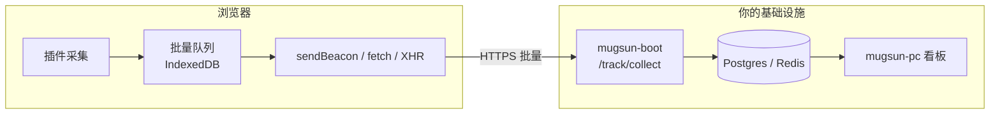

# @mugsun/track-web

[English](./README_EN.md) | 简体中文

埋点不该绑死一家云。  
`@mugsun/track-web` 把采集放进你自己的前端：core 约 **5.5KB gzip**，事件进你自己的库，看板跑在你自己的机器上。

[文档](https://docs.mugsun.com/track/) · [第一个事件](https://docs.mugsun.com/track/first-event) · [npm](https://www.npmjs.com/package/@mugsun/track-web)

[](https://www.npmjs.com/package/@mugsun/track-web)
[](#它做什么)
[](#本地开发)
[](./LICENSE)

```bash
pnpm add @mugsun/track-web
```

```ts
import { createTracker } from '@mugsun/track-web'

const track = createTracker({
  endpoint: 'https://your-server.com', // 实际上报 {endpoint}/track/collect
  appKey: 'your-app-key',              // 管理端「埋点分析 → 接入管理」新建
})

track.track('button_click', { name: 'buy' })
```

Vue 3 可直接挂路由与指令：

```ts
import MugsunTrack from '@mugsun/track-web/vue'
app.use(MugsunTrack, { endpoint, appKey, router })
```

从空环境到「看板里看到第一条事件」的完整路径：[文档 · 第一个事件](https://docs.mugsun.com/track/first-event)。

## 它做什么

多数产品分析工具默认把数据送进厂商云。这个 SDK 默认假设：**摄入、存储、看板都在你可控的环境里**——常见搭配是 [mugsun-boot](https://github.com/mugsun/mugsun-boot) 的 `/track/collect` 与 [mugsun-pc](https://github.com/mugsun/mugsun-pc) 看板；协议开放，也可以对接自建后端。

首包只带核心与默认插件（pageview / pageleave / autocapture / exposure / web-vitals / error）。会话回放、圈选埋点、接口监控、精确 geo 是**显式注册**的可选插件，走独立入口，不拖首屏。队列落 IndexedDB，断网或刷新后按指数退避补发；传输走 sendBeacon → fetch keepalive → XHR。每条事件有稳定的 `event_id`，方便服务端幂等去重。

隐私按「默认安全」设计：尊重 DNT；提供 `optOut()` / `optIn()`；不采集 input / textarea 的 value；password 与 `maskSelectors` 命中的子树整块屏蔽。回放默认遮罩输入。细节见 [隐私与合规](https://docs.mugsun.com/track/privacy)。

## 数据怎么走



appKey 在浏览器可见，**不是机密**。服务端靠存在性校验、按 appKey+IP 限流、有界队列背压与事件校验来防护，而不是指望把 key 藏起来。

## 和其它仓的关系

| 仓 | 职责 |
| --- | --- |
| **本仓** `@mugsun/track-web` | 浏览器 SDK（npm 可装；也可 `file:` 联调） |
| [mugsun-boot](https://github.com/mugsun/mugsun-boot) | 采集摄入、配置下发、聚合任务 |
| [mugsun-pc](https://github.com/mugsun/mugsun-pc) | 接入管理与分析看板；开发时常用 `file:../mugsun-track` |
| [mugsun-docs](https://github.com/mugsun/mugsun-docs) | 文档站 [docs.mugsun.com](https://docs.mugsun.com/) |

与 pc 平级开发时，源码仓不提交 `dist/`，需要先 `pnpm build`，或在 pc 里跑 `pnpm setup:sdk`。业务项目日常使用直接 `pnpm add @mugsun/track-web` 即可。

## 边界（老实说）

- **有**：可私有化的采集链路、轻量 core、可选回放/圈选/接口监控、断网补发与幂等 id、隐私默认值。
- **没有**：托管的公有云分析账号；目前也**没有**可点的公网 Demo（本地 compose + pc 看板是正路，见 [演示说明](https://docs.mugsun.com/demo)）。
- **不是** Google Analytics，也不是「只能用我们云」的产品分析 SaaS。
- API 全表、事件字段、插件配置以 [文档](https://docs.mugsun.com/track/) 为准，README 不复制说明书目录。

## 本地开发

```bash
pnpm install
pnpm test      # vitest，当前约 155 例
pnpm build     # 产出 dist/；体积门禁见 scripts/report-size.mjs（core gzip ≤ 8KB）
```

包名 `@mugsun/track-web`，版本以 npm / `package.json` 为准（当前 **0.1.0**）。导出入口包括主包、`/vue`、`/replay`、`/core`。

## License

[MIT](./LICENSE)
