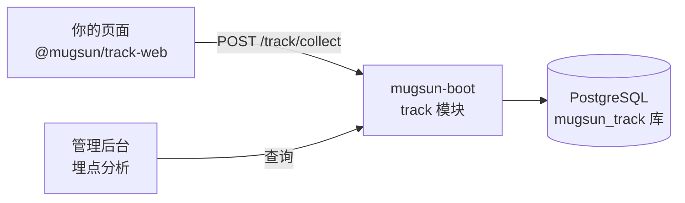

# @mugsun/track-web

[English](./README_EN.md) | [文档](https://docs.mugsun.com/track/) | [更新日志](./CHANGELOG.md)

[](https://www.npmjs.com/package/@mugsun/track-web)
[](https://github.com/mugsun/mugsun-track/actions/workflows/ci.yml)
[](./LICENSE)

mugsun 的浏览器埋点 SDK。它采集页面浏览、点击、性能指标和 JS 错误，上报到你自己部署的 [mugsun-boot](https://github.com/mugsun/mugsun-boot)。

采集、存储和分析都在你自己的服务器上完成。下图是管理后台里的会话回放。


## 安装

```bash
pnpm add @mugsun/track-web
```

```ts
import { createTracker } from '@mugsun/track-web'

const track = createTracker({
  endpoint: 'https://your-host', // mugsun-boot 的地址，不用加路径
  appKey: 'your-app-key', // 在管理后台「埋点分析 → 接入管理」里创建
  release: import.meta.env.VITE_APP_VERSION, // 可选，应用的版本号，建议构建时注入
})

track.track('button_click', { name: 'buy' })
```

创建之后，页面浏览、点击和错误会自动采集。`track.track()` 用来上报自己定义的事件。

`release` 可以不传。传了以后，错误事件会带上版本号，管理后台的错误问题单可以按版本筛选。

Vite 里用 `import.meta.env.VITE_*` 读取版本号，Webpack 里用 `process.env.*`，值可以由 CI 写入。

事件会出现在管理后台的「埋点分析 → 事件分析」里。完整步骤见[第一个事件](https://docs.mugsun.com/track/first-event)。

没看到事件时，在浏览器控制台运行自检。它会逐项检查配置，并给出修改建议：

```ts
const report = await track.selfCheck()
console.table(report.items)
```

### 在 Vue 3 里用

```ts
import MugsunTrack from '@mugsun/track-web/vue'

app.use(router)
app.use(MugsunTrack, { endpoint, appKey, router, release })
```

传入 `router` 后，页面事件按路由模板聚合，比如 `/order/:id`。模板里可以用 `$track` 和指令：

```vue
<button v-track:click="'buy_click'">购买</button>
<div v-track:exposure="{ event: 'banner_view', props: { id: 3 } }">Banner</div>
```

### 关联登录用户

```ts
track.identify(user.id) // 登录后
track.reset() // 退出登录后
```

全部方法和配置项见[安装与初始化](https://docs.mugsun.com/track/install)。

## 采集哪些数据

| 插件 | 默认 | 采集内容 |
| --- | --- | --- |
| `pageviewPlugin` | 开 | 首次加载和路由切换 |
| `pageleavePlugin` | 开 | 页面停留时长 |
| `autocapturePlugin` | 开 | 点击等交互 |
| `exposurePlugin` | 开 | 元素曝光 |
| `webVitalsPlugin` | 开 | 性能指标 Web Vitals |
| `errorPlugin` | 开 | JS 错误、资源加载错误和未处理的 Promise 拒绝 |
| `apiMonitorPlugin` | 关 | 请求的方法、地址、状态码和耗时 |
| `replayPlugin` | 关 | 会话回放，基于 rrweb |
| `visualTrack` | 关 | 圈选埋点，按管理后台下发的规则匹配元素 |
| `geoPlugin` | 关 | 精确位置，会触发浏览器的定位授权 |

默认关闭的插件要自己注册，写法见[插件](https://docs.mugsun.com/track/plugins)。

采样率可以在管理后台的接入管理里改，已注册的回放和接口监控也在那里开关。SDK 启动时会拉取这些配置，前端不用重新发版。

性能指标在「性能分析」页里是这样的：


## 隐私

SDK 创建后默认就开始采集。接入前请先看这几项默认行为：

- 默认尊重浏览器的 Do Not Track。调用 `optOut()` 停止采集，调用 `optIn()` 恢复。
- 自动采集的点击事件不带输入框的值。
- 回放默认关闭。开启后，页面文本和输入框的值按原文录制。要遮罩就传 `maskTextSelector` 和 `maskAllInputs`。
- 密码框、银行卡和一次性验证码字段在回放里始终不录。带 `data-track-mask` 属性的元素也不录。
- `appKey` 在浏览器里可见，只用来标识应用，不能当密钥用。

完整的行为清单和合规建议见[隐私与合规](https://docs.mugsun.com/track/privacy)。

## 断网和关闭页面时

- 事件先写入 IndexedDB，断网或刷新后会重新发送。
- 页面隐藏或关闭时，优先用 `sendBeacon` 发送。
- 每条事件带 `event_id`，服务端按它去重，重发不会产生重复数据。

## 入口和体积

| 入口 | 内容 | gzip 后 |
| --- | --- | --- |
| `@mugsun/track-web` | `createTracker` 和回放以外的所有插件 | 约 20 KB |
| `@mugsun/track-web/vue` | Vue 3 插件和指令 | 约 15 KB |
| `@mugsun/track-web/core` | 不依赖 DOM 的核心逻辑 | 约 7 KB |
| `@mugsun/track-web/replay` | 会话回放，不含 rrweb | 约 6 KB |

rrweb 在回放启用时才加载。`/core` 和 `/replay` 的体积在构建时检查，分别超过 8 KB 和 6 KB 就会失败。

## 数据怎么流动



埋点数据单独存在 `mugsun_track` 库里，和业务库分开。

## 本地开发

需要 Node.js 22.13+ 和 pnpm 11.11+。

```bash
pnpm install
pnpm test
pnpm build
```

`pnpm build` 会打印每个文件的体积。发版流程见[贡献指南](./CONTRIBUTING.md)。

## 目前的限制

- 只支持浏览器。
- 只能上报到 mugsun-boot，没有托管的云服务。
- 回放不录 canvas。
- 没有公网演示环境。

## 相关仓库

| 仓库 | 说明 |
| --- | --- |
| [mugsun-boot](https://github.com/mugsun/mugsun-boot) | 后端，接收事件并提供分析接口 |
| [mugsun-pc](https://github.com/mugsun/mugsun-pc) | 管理后台，接入管理和分析看板在这里 |
| [mugsun-docs](https://github.com/mugsun/mugsun-docs) | 文档站 [docs.mugsun.com](https://docs.mugsun.com/) 的源码 |

## 参与贡献

提交前请读[贡献指南](./CONTRIBUTING.md)。安全问题请按 [SECURITY.md](https://github.com/mugsun/.github/blob/main/SECURITY.md) 私下报告，不要开公开 Issue。

## 许可

MIT，见 [LICENSE](./LICENSE)。
