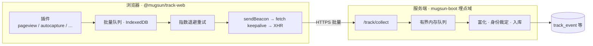

# @mugsun/track-web

[English](./README_EN.md) | 简体中文

mugsun 平台的 Web 行为埋点 SDK。框架无关的插件化内核，附官方 Vue 3 集成；会话回放走独立入口按需加载。面向要自建采集与看板的团队——也可只接本 SDK、对接自建后端。

文档：[docs.mugsun.com](https://docs.mugsun.com/) · 站点：[mugsun.com](https://mugsun.com) · npm：[`@mugsun/track-web`](https://www.npmjs.com/package/@mugsun/track-web)

[](https://www.npmjs.com/package/@mugsun/track-web)
[](#工程)
[](./tsconfig.json)
[](#工程)
[](./LICENSE)

`package.json` 版本 **0.1.0**。`dist/core.js` 构建实测 gzip **约 5.5KB**（门禁 ≤ 8KB，见 `scripts/report-size.mjs`）。core 零 DOM 依赖，存储 / 传输 / 时钟均可注入，单元测试可在 Node 跑。

## 设计要点

- **体积**：core gzip ~5.5KB；回放在 `@mugsun/track-web/replay`，不进主入口首包
- **插件化**：默认 6 个插件；可选 4 个（接口监控、会话回放、圈选埋点、精确位置）需显式注册
- **投递**：批量队列 IndexedDB 持久化；断网 / 刷新后指数退避补发；sendBeacon → fetch keepalive → XHR；可选 gzip（CompressionStream）
- **幂等**：`event_id` = `crypto.randomUUID`，跨重发稳定，供服务端去重
- **会话**：30 分钟滑动过期（localStorage）；同浏览器多标签共享，任一活动续期
- **采样**：按 anonymous_id 哈希分桶，会话级一致
- **隐私默认**：尊重 DNT；`optOut()`；不采 input/textarea 的 value；password 与 `maskSelectors` 子树整块屏蔽

## 数据流



配套服务端为 [mugsun-boot](https://github.com/mugsun/mugsun-boot) 埋点域（`/track/collect`、配置下发、聚合与看板）。也可对接自建后端（事件协议见下）。

## 安装

已发布到 npm，应用侧可直接安装：

```bash
npm i @mugsun/track-web
# 或
pnpm add @mugsun/track-web
# 或
yarn add @mugsun/track-web
```

<details>
<summary>本地联调 / 与 mugsun-pc 同仓开发：<code>file:</code> 协议（须先 build）</summary>

[mugsun-pc](https://github.com/mugsun/mugsun-pc) 的 `package.json` 使用 `"@mugsun/track-web": "file:../mugsun-track"`。源码仓**不提交** `dist/`，须先构建：

```bash
cd mugsun-track && pnpm install && pnpm build

# 其它宿主项目也可：
pnpm add @mugsun/track-web@file:../mugsun-track
```

pc 仓亦提供 `pnpm setup:sdk`（对 `../mugsun-track` 执行 install + build）。

</details>

## 获取 appKey

1. 管理端：**埋点分析 → 接入管理**，新建应用拿到 appKey  
2. 初始化填入 `appKey` 与 `endpoint`  
3. 启动时拉取 `GET {endpoint}/track/config?app_key=…`（采样、总开关、屏蔽选择器、回放 / 接口监控 / 圈选 / geo 等），**下次启动生效**

appKey 在浏览器可见，不是机密；服务端靠存在性校验、限流、背压与事件校验防护。

## 快速开始

### 任意站点（core）

```ts
import { createTracker } from '@mugsun/track-web'

const track = createTracker({
  endpoint: 'https://your-server.com', // collect = {endpoint}/track/collect
  appKey: 'your-app-key',
  release: '1.0.0'
})

track.track('button_click', { name: 'buy' })
```

### Vue 3

```ts
import { createApp } from 'vue'
import MugsunTrack from '@mugsun/track-web/vue'
import router from './router'

const app = createApp(App)
app.use(MugsunTrack, {
  endpoint: import.meta.env.VITE_TRACK_ENDPOINT,
  appKey: import.meta.env.VITE_TRACK_APP_KEY,
  release: import.meta.env.VITE_APP_VERSION,
  router // route_path 取 matched 模板；afterEach 驱动 SPA pageview 配对
})
app.mount('#app')
```

组件内：`inject(TRACK_INJECT_KEY)`；模板外：`app.config.globalProperties.$track`。

```ts
track.identify(userId) // 登录后绑定
track.reset()          // 登出：清身份、换 anonymous_id、开新会话
```

## API

| 方法 | 说明 |
| --- | --- |
| `track(event, props?)` | 自定义事件 |
| `identify(userId)` | 绑定登录用户，上报 `$identify` |
| `reset()` | 登出 / 切号 |
| `timeEvent(name)` / `cancelTimeEvent(name)` | 计时；随后 `track(name)` 带 `duration_ms` |
| `registerSuperProperties(props)` / `unregisterSuperProperty(key)` | 超级属性 |
| `flush()` / `flushBeacon()` | 立即冲刷；后者优先 beacon（卸载场景） |
| `optOut()` / `optIn()` / `isOptedOut()` | 停止 / 恢复采集（持久化）；optOut 清空待发队列 |
| `getDistinctId()` / `getUserId()` / `getSessionId()` | 身份与会话 |
| `setRoutePathProvider(fn)` | 非 Vue 场景的路由模板 |
| `onSessionChange(listener)` | 会话变更回调 |
| `destroy()` | 拆卸插件与定时器 |

## v-track（Vue）

```vue
<template>
  <button v-track:click="'cta_click'">立即购买</button>
  <button v-track:click="{ event: 'cta_click', props: { pos: 'hero' } }">立即购买</button>
  <div v-track:exposure="{ event: 'banner_view', props: { id: 1 } }">...</div>
</template>
```

曝光：可见 ≥50% 且持续 ≥1s；同会话同元素同参数只记一次。

## 插件清单

| 插件 | 事件 | 默认 | 说明 |
| --- | --- | --- | --- |
| pageview | `$pageview` / `$pageleave` | 开 | history + popstate/hashchange；路由切换成对补发 |
| pageleave | `$pageleave` | 开 | Page Visibility 停留；hidden/pagehide beacon |
| autocapture | `$click` / `form_submit` | 开 | 不采 value；password / maskSelectors 整块屏蔽；文本截断 64 |
| exposure | `$exposure` 或自定义 | 开 | IntersectionObserver ≥50% × ≥1s |
| web-vitals | `$web_vitals` | 开 | LCP/INP/CLS/FCP/TTFB/longtask |
| error | `$error` | 开 | error + unhandledrejection；`error_fingerprint` |
| api-monitor | `api_request` | **关** | 包装 fetch/XHR；排除 `/track/*`；可选响应体 `/track/api-body` |
| replay | 回放块（非事件） | **关** | 入口 `@mugsun/track-web/replay` |
| visual-track | 圈选自定义事件 | **关** | 规则经 `/track/config`；`__mst_inspect` 进圈选模式 |
| geo | 超属性 `geo_lon` / `geo_lat` | **关** | `/track/config` 的 `geoEnabled`；每会话至多一次定位 |

会话事件：`$session_start` / `$session_end`（30 分钟静默轮换，end 含 `duration_ms`）。

### 会话回放

```ts
import { createTracker, defaultPlugins } from '@mugsun/track-web'
import { replayPlugin } from '@mugsun/track-web/replay'

createTracker({
  endpoint,
  appKey,
  plugins: [...defaultPlugins(), replayPlugin()]
})
```

常录 + 选择性上传：`replayEnabled` 开启才录；命中 `replaySampleRate`（默认 10%）或会话内 `$error` 则上传；独立通道 `POST {endpoint}/track/replay`。默认 `maskAllInputs: true`，不采 canvas。

### 圈选埋点

```ts
import { createTracker, defaultPlugins, visualTrack } from '@mugsun/track-web'

createTracker({
  endpoint,
  appKey,
  plugins: [...defaultPlugins(), visualTrack()]
})
```

### 精确位置（geo）

```ts
import { createTracker, defaultPlugins, geoPlugin } from '@mugsun/track-web'

createTracker({
  endpoint,
  appKey,
  plugins: [...defaultPlugins(), geoPlugin()]
})
```

仅当远端 / 本地 `geoEnabled === true` 时征求定位；拒绝或失败静默。

### 自定义组合

```ts
import { createTracker, defaultPlugins, apiMonitorPlugin } from '@mugsun/track-web'

createTracker({
  endpoint,
  appKey,
  plugins: [...defaultPlugins(), apiMonitorPlugin()]
})
```

## 配置项

| 配置 | 默认 | 说明 |
| --- | --- | --- |
| `appKey` / `endpoint` | 必填 | 应用标识 / 服务端根地址 |
| `release` | — | 版本号，`$error` 等携带 |
| `sampleRate` | 100 | 0–100；远端优先，下次启动生效 |
| `enabled` | true | 本地总开关 |
| `batchSize` / `flushInterval` | 10 / 5000 | 条数或间隔双触发 |
| `maxBatchSize` | 100 | 单请求上限 |
| `queueCapacity` / `queueMaxAge` | 500 / 24h | 超限丢最旧；超龄丢弃 |
| `retryBaseDelay` / `retryMaxDelay` | 1000 / 30000 | 退避 `base×2ⁿ` 封顶 |
| `respectDnt` | true | 尊重 DNT |
| `maskSelectors` | [] | 与远端合并 |
| `replayEnabled` / `replaySampleRate` | false / 10 | 回放开关与会话采样 |
| `apiMonitorEnabled` / `apiBody*` | 未设则远端 | 接口监控与响应体 |
| `visualRules` | 未设则远端 | 圈选规则 |
| `geoEnabled` | 未设则远端 | 精确位置 |
| `sessionTimeout` | 30min | 滑动过期 |
| `storagePrefix` | `mst` | localStorage 前缀 |
| `plugins` | 默认 6 插件 | 见清单 |
| `fetchRemoteConfig` | true | 启动拉配置 |
| `headers` | — | 上报附加头（如 Authorization）；beacon 无法携带 |
| `debug` | false | 控制台日志 |

## 事件协议

```
POST {endpoint}/track/collect
{
  app_key, schema_version,
  sdk: { platform: 'web', version },
  sent_at,
  events: [{ event_id, event, ts, distinct_id, user_id, session_id, props }]
}
```

- `$` 前缀为服务端保留字；自定义事件名须匹配 `^[A-Za-z][A-Za-z0-9_]{0,63}$`
- 公共属性含 `url_path` / `route_path` 双写、UTM、viewport 等
- `distinct_id` 恒为 anonymous_id；事件级 `user_id` 以服务端 token 裁定为准

## 隐私

- DNT + `respectDnt`（默认开）时不采集  
- `optOut()` 停止并清空本地队列  
- 不采 input/textarea value；password 与 maskSelectors 整块屏蔽  
- 回放默认遮罩全部输入；主采样未命中或 optOut 不录制  
- 不收集 cookie / localStorage 内容；接口监控 url 去掉查询串  

## 工程

```bash
pnpm install
pnpm build      # tsup：ESM + CJS + d.ts；报告 gzip；core 门禁 ≤ 8KB
pnpm test       # vitest（当前 18 文件 / 155 用例）
pnpm typecheck  # tsc --noEmit
```

| 入口 | 内容 |
| --- | --- |
| `@mugsun/track-web` | `createTracker` + 默认插件（浏览器适配） |
| `@mugsun/track-web/core` | 纯逻辑 core（体积门禁对象） |
| `@mugsun/track-web/vue` | Vue 插件、`v-track`、router、errorHandler |
| `@mugsun/track-web/replay` | 会话回放（rrweb 动态 import） |

环境：Node.js ≥ 20（见 `engines`）。提交约定：[.github/COMMIT_CONVENTION.md](.github/COMMIT_CONVENTION.md)。

## 相关仓库

| 仓库 | 角色 |
| --- | --- |
| [mugsun-boot](https://github.com/mugsun/mugsun-boot) | 采集 / 配置 / 聚合 / 看板后端 |
| [mugsun-pc](https://github.com/mugsun/mugsun-pc) | 管理前端（`file:../mugsun-track` 联调） |
| [mugsun-docs](https://github.com/mugsun/mugsun-docs) | 文档 → [docs.mugsun.com](https://docs.mugsun.com/) |

## 许可证

[MIT License](./LICENSE)
