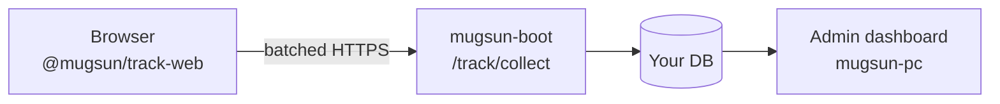

<p align="center">
  
</p>

# @mugsun/track-web

[简体中文](./README.md) | English

**Ship “collect → private backend → dashboard” in your own repos.**  
~5.5KB gzip core, privacy defaults on, session replay off the critical path.

[Docs](https://docs.mugsun.com/en/track/) · [Getting started](https://docs.mugsun.com/en/guide/getting-started) · [npm](https://www.npmjs.com/package/@mugsun/track-web) · [Demo (coming soon)](https://docs.mugsun.com/en/demo)

[](https://www.npmjs.com/package/@mugsun/track-web)
[](#why-this)
[](#engineering)
[](./LICENSE)

---

## Why this

Most analytics tools force a trade-off: lock into a cloud SaaS, or maintain a heavy in-house script. This SDK takes a third path—

1. **Your database**: talks to [mugsun-boot](https://github.com/mugsun/mugsun-boot) `/track/collect` by default, or any backend that speaks the same event protocol.
2. **Small first paint**: ~5.5KB gzip core; replay / visual tagging / API monitor are opt-in.
3. **Safe defaults**: honors DNT; never reads input values; masks password trees and custom selectors; supports `optOut()`.

Not Google Analytics. Not another hosted product-analytics cloud.

---

## 30-second start

```bash
pnpm add @mugsun/track-web
```

```ts
import { createTracker } from '@mugsun/track-web'

const track = createTracker({
  endpoint: 'https://your-server.com', // posts to {endpoint}/track/collect
  appKey: 'your-app-key',
})

track.track('button_click', { name: 'buy' })
```

Vue 3:

```ts
import MugsunTrack from '@mugsun/track-web/vue'
app.use(MugsunTrack, { endpoint, appKey, router })
```

Full path to “first event on the dashboard”: [docs · first event](https://docs.mugsun.com/en/track/first-event).

---

## Shape



> **Screenshot placeholder** — public demo screenshots land here when ready. Until then, run boot + pc locally. See [Demo](https://docs.mugsun.com/en/demo).

---

## Honest boundaries

- **Includes**: plugin collect, offline retry, stable `event_id`, DNT/masking, optional replay & visual tagging.
- **Does not include**: a hosted analytics account; a live public demo yet.
- **appKey is not a secret** — browser-visible; server enforces existence, rate limits, and backpressure.
- Deep reference lives in [docs](https://docs.mugsun.com/en/track/), not a feature wall in this README.

---

## Engineering

```bash
pnpm install && pnpm test && pnpm build
```

Current package version **0.1.0**; core gzip gate ≤ 8KB.

## License

[MIT](./LICENSE)
