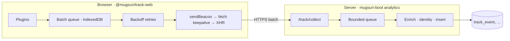

# @mugsun/track-web

English | [简体中文](./README.md)

Web analytics SDK for the mugsun platform: a framework-agnostic, plugin-based kernel with an official Vue 3 integration. Session replay loads from a separate entry. Use it with mugsun-boot, or point it at your own backend.

Docs: [docs.mugsun.com](https://docs.mugsun.com/) · Site: [mugsun.com](https://mugsun.com) · npm: [`@mugsun/track-web`](https://www.npmjs.com/package/@mugsun/track-web)

[](https://www.npmjs.com/package/@mugsun/track-web)
[](#engineering)
[](./tsconfig.json)
[](#engineering)
[](./LICENSE)

Package version **0.1.0**. Measured `dist/core.js` gzip is **~5.5KB** (build gate ≤ 8KB via `scripts/report-size.mjs`). The core has zero DOM dependencies; storage, transport, and clock are injected so unit tests run in Node.

## Design notes

- **Size**: ~5.5KB gzipped core; replay lives at `@mugsun/track-web/replay` and stays out of the main entry
- **Plugins**: six defaults; four opt-in (API monitor, session replay, visual tracking, geo) registered explicitly
- **Delivery**: IndexedDB-backed batch queue; exponential backoff across reloads/offline; sendBeacon → fetch keepalive → XHR; optional gzip
- **Idempotency**: stable `crypto.randomUUID` `event_id` for server-side dedupe
- **Sessions**: 30-minute sliding expiry in localStorage; tabs share one session
- **Sampling**: hash-bucketed on anonymous_id, stable per session
- **Privacy defaults**: respects DNT; `optOut()`; never captures input values; masks password fields and `maskSelectors` subtrees

## Data flow



Server counterpart: [mugsun-boot](https://github.com/mugsun/mugsun-boot) analytics domain. A custom backend works if it speaks the collect protocol below.

## Install

Published on npm:

```bash
npm i @mugsun/track-web
# or
pnpm add @mugsun/track-web
# or
yarn add @mugsun/track-web
```

<details>
<summary>Local / sibling-repo setup with <code>file:</code> (build required)</summary>

[mugsun-pc](https://github.com/mugsun/mugsun-pc) depends on `"@mugsun/track-web": "file:../mugsun-track"`. This repo does **not** commit `dist/` — build first:

```bash
cd mugsun-track && pnpm install && pnpm build

# Other hosts:
pnpm add @mugsun/track-web@file:../mugsun-track
```

pc also exposes `pnpm setup:sdk` (install + build against `../mugsun-track`).

</details>

## Getting an appKey

1. In the admin UI: **Analytics → App management**, create an app and copy the appKey  
2. Pass `appKey` and `endpoint` into the SDK  
3. On start, the SDK fetches `GET {endpoint}/track/config?app_key=…` (sample rate, toggles, masks, replay / API monitor / visual rules / geo). Changes apply on the **next** start

The appKey is visible in the browser; it is not a secret. Server protection is validation, rate limits, backpressure, and event checks.

## Quick start

### Any site (core)

```ts
import { createTracker } from '@mugsun/track-web'

const track = createTracker({
  endpoint: 'https://your-server.com', // collect = {endpoint}/track/collect
  appKey: 'your-app-key',
  release: '1.0.0'
})

track.track('button_click', { name: 'buy' })
```

### Vue 3

```ts
import { createApp } from 'vue'
import MugsunTrack from '@mugsun/track-web/vue'
import router from './router'

const app = createApp(App)
app.use(MugsunTrack, {
  endpoint: import.meta.env.VITE_TRACK_ENDPOINT,
  appKey: import.meta.env.VITE_TRACK_APP_KEY,
  release: import.meta.env.VITE_APP_VERSION,
  router // matched route template for route_path; afterEach drives SPA pageviews
})
app.mount('#app')
```

In components: `inject(TRACK_INJECT_KEY)`. Outside templates: `app.config.globalProperties.$track`.

```ts
track.identify(userId) // after login
track.reset()          // logout: clear identity, rotate anonymous_id & session
```

## API

| Method | Purpose |
| --- | --- |
| `track(event, props?)` | Custom event |
| `identify(userId)` | Bind logged-in user (`$identify`) |
| `reset()` | Logout / account switch |
| `timeEvent(name)` / `cancelTimeEvent(name)` | Timing; next `track(name)` gets `duration_ms` |
| `registerSuperProperties(props)` / `unregisterSuperProperty(key)` | Super properties |
| `flush()` / `flushBeacon()` | Flush now; beacon-first for unload |
| `optOut()` / `optIn()` / `isOptedOut()` | Stop/resume (persisted); optOut clears the queue |
| `getDistinctId()` / `getUserId()` / `getSessionId()` | Identity & session |
| `setRoutePathProvider(fn)` | Route template outside Vue |
| `onSessionChange(listener)` | Session change callback |
| `destroy()` | Tear down plugins and timers |

## v-track (Vue)

```vue
<template>
  <button v-track:click="'cta_click'">Buy</button>
  <button v-track:click="{ event: 'cta_click', props: { pos: 'hero' } }">Buy</button>
  <div v-track:exposure="{ event: 'banner_view', props: { id: 1 } }">...</div>
</template>
```

Exposure: ≥50% visible for ≥1s; once per session/element/params.

## Plugins

| Plugin | Events | Default | Notes |
| --- | --- | --- | --- |
| pageview | `$pageview` / `$pageleave` | on | history + popstate/hashchange |
| pageleave | `$pageleave` | on | visibility-based dwell; beacon on hidden/pagehide |
| autocapture | `$click` / `form_submit` | on | no values; password / maskSelectors blocked; text truncated to 64 |
| exposure | `$exposure` or custom | on | IntersectionObserver ≥50% × ≥1s |
| web-vitals | `$web_vitals` | on | LCP/INP/CLS/FCP/TTFB/longtask |
| error | `$error` | on | error + unhandledrejection; `error_fingerprint` |
| api-monitor | `api_request` | **off** | wraps fetch/XHR; skips `/track/*`; optional body channel |
| replay | replay chunks | **off** | entry `@mugsun/track-web/replay` |
| visual-track | custom events | **off** | rules from `/track/config`; `__mst_inspect` for picker mode |
| geo | super props `geo_lon` / `geo_lat` | **off** | `geoEnabled` from config; at most one locate per session |

Session events: `$session_start` / `$session_end` (30-minute idle rotation).

### Session replay

```ts
import { createTracker, defaultPlugins } from '@mugsun/track-web'
import { replayPlugin } from '@mugsun/track-web/replay'

createTracker({
  endpoint,
  appKey,
  plugins: [...defaultPlugins(), replayPlugin()]
})
```

Always-record + selective upload: recording requires `replayEnabled`; upload when `replaySampleRate` hits (default 10%) or on in-session `$error`. Channel: `POST {endpoint}/track/replay`. Defaults: `maskAllInputs: true`, no canvas capture.

### Visual tracking

```ts
import { createTracker, defaultPlugins, visualTrack } from '@mugsun/track-web'

createTracker({
  endpoint,
  appKey,
  plugins: [...defaultPlugins(), visualTrack()]
})
```

### Geo

```ts
import { createTracker, defaultPlugins, geoPlugin } from '@mugsun/track-web'

createTracker({
  endpoint,
  appKey,
  plugins: [...defaultPlugins(), geoPlugin()]
})
```

Locates only when `geoEnabled === true`; denial/failure is silent.

### Custom plugin list

```ts
import { createTracker, defaultPlugins, apiMonitorPlugin } from '@mugsun/track-web'

createTracker({
  endpoint,
  appKey,
  plugins: [...defaultPlugins(), apiMonitorPlugin()]
})
```

## Options

| Option | Default | Notes |
| --- | --- | --- |
| `appKey` / `endpoint` | required | App id / server root |
| `release` | — | App version on `$error`, etc. |
| `sampleRate` | 100 | 0–100; remote wins, next start |
| `enabled` | true | Local master switch |
| `batchSize` / `flushInterval` | 10 / 5000 | Count or interval flush |
| `maxBatchSize` | 100 | Per-request cap |
| `queueCapacity` / `queueMaxAge` | 500 / 24h | Drop-oldest / drop-stale |
| `retryBaseDelay` / `retryMaxDelay` | 1000 / 30000 | `base×2ⁿ` capped |
| `respectDnt` | true | Honor DNT |
| `maskSelectors` | [] | Merged with remote |
| `replayEnabled` / `replaySampleRate` | false / 10 | Replay toggle & session sample |
| `apiMonitorEnabled` / `apiBody*` | remote if unset | API monitor & response body |
| `visualRules` | remote if unset | Visual rules |
| `geoEnabled` | remote if unset | Precise location |
| `sessionTimeout` | 30min | Sliding expiry |
| `storagePrefix` | `mst` | localStorage prefix |
| `plugins` | six defaults | See table |
| `fetchRemoteConfig` | true | Fetch config on start |
| `headers` | — | Extra headers (e.g. Authorization); not on beacon |
| `debug` | false | Console logs |

## Event protocol

```
POST {endpoint}/track/collect
{
  app_key, schema_version,
  sdk: { platform: 'web', version },
  sent_at,
  events: [{ event_id, event, ts, distinct_id, user_id, session_id, props }]
}
```

- `$`-prefixed names are server-reserved; custom names must match `^[A-Za-z][A-Za-z0-9_]{0,63}$`
- Common props include `url_path` / `route_path`, UTM, viewport, …
- `distinct_id` is always the anonymous id; event-level `user_id` is decided server-side from the token

## Privacy

- No collection when DNT is on and `respectDnt` is true (default)  
- `optOut()` stops collection and clears the local queue  
- No input/textarea values; password and maskSelectors subtrees blocked  
- Replay masks all inputs by default; no recording when main sample misses or opted out  
- No cookie/localStorage scraping; API-monitor URLs strip query strings  

## Engineering

```bash
pnpm install
pnpm build      # tsup ESM + CJS + d.ts; gzip report; core gate ≤ 8KB
pnpm test       # vitest (currently 18 files / 155 cases)
pnpm typecheck  # tsc --noEmit
```

| Entry | Contents |
| --- | --- |
| `@mugsun/track-web` | `createTracker` + default plugins (browser adapters) |
| `@mugsun/track-web/core` | Pure-logic core (size-gate target) |
| `@mugsun/track-web/vue` | Vue plugin, `v-track`, router, errorHandler |
| `@mugsun/track-web/replay` | Session replay (dynamic `rrweb` import) |

Requires Node.js ≥ 20. Commit style: [.github/COMMIT_CONVENTION.md](.github/COMMIT_CONVENTION.md).

## Related

| Repo | Role |
| --- | --- |
| [mugsun-boot](https://github.com/mugsun/mugsun-boot) | Collect / config / aggregate / dashboards |
| [mugsun-pc](https://github.com/mugsun/mugsun-pc) | Admin UI (`file:../mugsun-track` for local) |
| [mugsun-docs](https://github.com/mugsun/mugsun-docs) | Docs → [docs.mugsun.com](https://docs.mugsun.com/) |

## License

[MIT License](./LICENSE)
