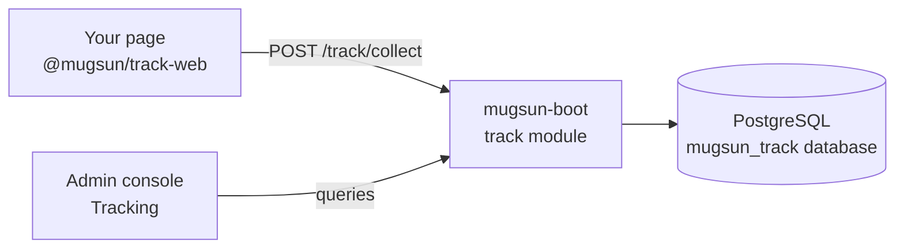

# @mugsun/track-web

[中文](./README.md) | [Docs](https://docs.mugsun.com/en/track/) | [Changelog](./CHANGELOG.md)

[](https://www.npmjs.com/package/@mugsun/track-web)
[](https://github.com/mugsun/mugsun-track/actions/workflows/ci.yml)
[](./LICENSE)

The browser tracking SDK of mugsun. It collects page views, clicks, performance metrics and JavaScript errors and sends them to a [mugsun-boot](https://github.com/mugsun/mugsun-boot) that you host yourself.

Collection, storage and analysis all stay on your own servers. Below is session replay in the admin console.


## Install

```bash
pnpm add @mugsun/track-web
```

```ts
import { createTracker } from '@mugsun/track-web'

const track = createTracker({
  endpoint: 'https://your-host', // where mugsun-boot runs; no path needed
  appKey: 'your-app-key', // create one under Tracking > Integration in the admin console
  release: import.meta.env.VITE_APP_VERSION, // optional: your app's version, best injected at build time
})

track.track('button_click', { name: 'buy' })
```

Once the tracker is created, page views, clicks and errors are collected automatically. `track.track()` sends events you define yourself.

`release` is optional. When it is set, error events carry the version, and error issues in the admin console can be filtered by it.

Read the version from `import.meta.env.VITE_*` in Vite or from `process.env.*` in Webpack. CI can set the value.

Events show up under Tracking > Event Analysis in the admin console. The full walkthrough is in [First event](https://docs.mugsun.com/en/track/first-event).

If nothing shows up, run the self-check in the browser console. It goes through the setup item by item and suggests a fix for each problem:

```ts
const report = await track.selfCheck()
console.table(report.items)
```

### With Vue 3

```ts
import MugsunTrack from '@mugsun/track-web/vue'

app.use(router)
app.use(MugsunTrack, { endpoint, appKey, router, release })
```

With `router` passed in, page events are grouped by route pattern, such as `/order/:id`. Templates can use `$track` and the directive:

```vue
<button v-track:click="'buy_click'">Buy</button>
<div v-track:exposure="{ event: 'banner_view', props: { id: 3 } }">Banner</div>
```

### Link events to a signed-in user

```ts
track.identify(user.id) // after sign-in
track.reset() // after sign-out
```

All methods and options are listed in [Install and initialise](https://docs.mugsun.com/en/track/install).

## What it collects

| Plugin | Default | Collects |
| --- | --- | --- |
| `pageviewPlugin` | on | First load and route changes |
| `pageleavePlugin` | on | Time spent on a page |
| `autocapturePlugin` | on | Clicks and other interactions |
| `exposurePlugin` | on | Element exposure |
| `webVitalsPlugin` | on | Web Vitals |
| `errorPlugin` | on | JavaScript errors, failed resource loads and unhandled promise rejections |
| `apiMonitorPlugin` | off | Method, URL, status code and duration of requests |
| `replayPlugin` | off | Session replay, built on rrweb |
| `visualTrack` | off | Events defined by point-and-click rules from the admin console |
| `geoPlugin` | off | Precise location; triggers the browser's permission prompt |

Plugins that are off by default have to be registered in code. See [Plugins](https://docs.mugsun.com/en/track/plugins).

The sample rate can be changed on the Integration page of the admin console, and replay and API monitoring are switched there once registered. The SDK fetches these settings at startup, so the frontend needs no new release.

This is how performance metrics look on the Performance Analysis page:


## Privacy

The SDK starts collecting as soon as it is created. Read these defaults before you integrate it:

- Do Not Track is respected by default. `optOut()` stops collection and `optIn()` resumes it.
- Automatically captured clicks never include the value of an input.
- Replay is off by default. When it is on, page text and input values are recorded as they are. Pass `maskTextSelector` and `maskAllInputs` to mask them.
- Password fields, card fields and one-time-code fields are never recorded in replay. Neither is any element with the `data-track-mask` attribute.
- `appKey` is visible in the browser. It only identifies the application and must not be used as a secret.

The full list of behaviours and the compliance advice are in [Privacy](https://docs.mugsun.com/en/track/privacy).

## Offline and page close

- Events are written to IndexedDB first and sent again after a network failure or a reload.
- When the page is hidden or closed, `sendBeacon` is tried first.
- Every event has an `event_id`. The server deduplicates by it, so a resend does not create duplicate data.

## Entry points and size

| Entry | Contents | Gzipped |
| --- | --- | --- |
| `@mugsun/track-web` | `createTracker` and every plugin except replay | about 20 KB |
| `@mugsun/track-web/vue` | Vue 3 plugin and directive | about 15 KB |
| `@mugsun/track-web/core` | Core logic with no DOM dependency | about 7 KB |
| `@mugsun/track-web/replay` | Session replay, without rrweb | about 6 KB |

rrweb is loaded only when replay is enabled. The build checks the size of `/core` and `/replay` and fails above 8 KB and 6 KB.

## How data flows



Tracking data is kept in its own database, `mugsun_track`, apart from the business database.

## Local development

You need Node.js 22.13+ and pnpm 11.11+.

```bash
pnpm install
pnpm test
pnpm build
```

`pnpm build` prints the size of every file. The release process is in the [contributing guide](./CONTRIBUTING.md).

## Current limits

- Browsers only.
- It can only report to mugsun-boot. There is no hosted cloud service.
- Replay does not record canvas.
- There is no public demo.

## Related repositories

| Repository | What it is |
| --- | --- |
| [mugsun-boot](https://github.com/mugsun/mugsun-boot) | The backend. It receives the events and serves the analysis APIs |
| [mugsun-pc](https://github.com/mugsun/mugsun-pc) | The admin console, with the integration page and the dashboards |
| [mugsun-docs](https://github.com/mugsun/mugsun-docs) | Source of the documentation site, [docs.mugsun.com](https://docs.mugsun.com/en/) |

## Contributing

Read the [contributing guide](https://github.com/mugsun/.github/blob/main/CONTRIBUTING_EN.md) before you send a change. Report security issues privately as described in [SECURITY.md](https://github.com/mugsun/.github/blob/main/SECURITY.md). Please do not open a public issue.

## License

MIT, see [LICENSE](./LICENSE).
